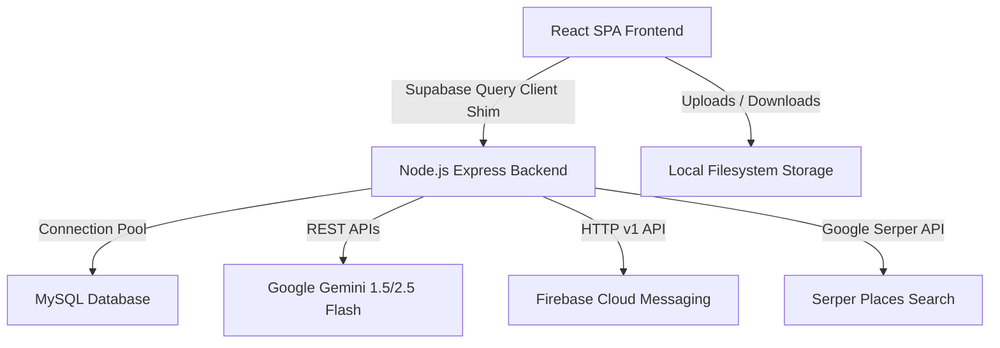

# 🏥 HealthSync

HealthSync is a comprehensive, production-grade healthcare coordination platform designed to unify **Citizens, Doctors, Hospitals, and Diagnostic Centers** into a single digital ecosystem. Built with a modern **React SPA frontend** and a robust **Node.js Express + MySQL backend**, HealthSync utilizes **Google Gemini AI** for clinical OCR and intelligence, **Firebase Cloud Messaging (FCM)** for critical blood donor notifications, and a custom **Supabase Client Shim** to simulate standard cloud backend operations locally.

---

## 🏗️ System Architecture

HealthSync is structured to run fully locally, decoupling the client and server while maintaining a Supabase-like development experience:



### Key Architectural Layers
1. **Frontend (React SPA)**: Structured using features-based folders. Includes a custom-built API wrapper mimicking `@supabase/supabase-js` database, authentication, storage, and function execution APIs.
2. **Backend (Express API)**: Serves endpoints for auth, database queries (dynamic SQL translation), local file uploads, and edge-function equivalents.
3. **Database (MySQL)**: Standard relational schema. Includes safety indexes, foreign keys, and automatic schema initialization for runtime safety.
4. **AI Engine (Gemini)**: Powers bilingual medical OCR, symptom-to-specialist triage, automated nutrition plan generation, and blood request entity extraction.

---

## 👥 Core Features & User Roles

HealthSync partitions dashboards, privileges, and tools based on four primary user roles:

### 1. 🟢 Citizen (Patient)
*   **Lifelong Medical Timeline**: A visual feed of all prescriptions, lab tests, vaccinations, and surgeries.
*   **AI Medical OCR Analyzer**: Upload report images or PDFs. Gemini reads the document, classifies it, highlights key values, and generates easy-to-read explanations in both English and Bengali.
*   **AI Symptom Triage**: Enter active symptoms to receive urgency assessment, suggested specialist categories, and immediate self-care advice.
*   **AI Daily Health Plans**: Automatically compiles medical history to outline custom diet, exercise, and precautions.
*   **Emergency Blood Request**: Request blood units. The system extracts blood details using AI and broadcasts push alerts to matching donors.

### 2. 🔵 Doctor
*   **Patient Panel**: Monitor all citizens who have visited the chamber or have active appointments.
*   **Medical Timeline Inspection**: Gain read access to the citizen's shared history (reports, previous prescriptions, and diagnostics) to inform clinical decisions.
*   **Appointment Management**: Approve, reject, or schedule appointments.
*   **Chamber & Fee Roster**: Set consultation fees, chamber locations, and slot timings.

### 3. 🟡 Hospital
*   **Doctor Roster Management**: Recruit and link doctors to the hospital staff.
*   **Patient Bed Registry**: Assign and check patients into hospital rooms/beds.
*   **Blood Bank Inventory**: Real-time units tracker for all blood groups (`A+`, `O-`, etc.).
*   **Front-Desk Reception**: Register walk-in patients, allocate appointments, and manage schedules.

### 4. 🟣 Diagnostic Center
*   **Test Invoicing**: Create bills and invoice records for clinical tests (e.g., CBC, Lipid Profile).
*   **Work Order Progress**: Track payment statuses (`PAID`, `DUE`) and report completion (`PENDING`, `COMPLETED`).
*   **Digital Result Delivery**: Upload scanned reports directly to the patient's digital account, immediately feeding their timeline and notifying them.

---

## ⚡ Technical Innovations

### 🔗 Custom Supabase-to-MySQL Shim
To leverage the developer-friendly syntax of Supabase on a local relational MySQL database, HealthSync implements a query compiler:

*   **Client Interface** (`frontend/src/shared/lib/supabaseClient.ts`):
    ```typescript
    // standard Supabase syntax used across frontend code:
    const { data, error } = await supabase
      .from('medical_events')
      .select('*, profiles:User(*)')
      .eq('patient_id', id)
      .order('event_date', { ascending: false });
    ```
*   **Dynamic Query Broker** (`backend/src/routes/db.ts`):
    The shim sends this structure as an HTTP POST to `/api/db/query`. The backend parses the query structure, dynamically constructs a secure parameterized SQL query with the correct `INNER/LEFT JOIN` statements, retrieves the rows, parses nested JSON, bundles joined tables back into nested objects, and responds in the exact shape the `@supabase/supabase-js` library outputs.

---

### 🧠 Google Gemini AI Integrations
HealthSync incorporates AI directly into backend routes (`backend/src/routes/functions.ts`):

| Feature Endpoint | Gemini Model | Task Description | Response Format |
| :--- | :--- | :--- | :--- |
| `/api/functions/process-medical-report` | `gemini-1.5-flash` / `2.5-flash` | Performs OCR on report/prescription image, classifies document type, extracts critical findings, flags abnormal ranges, and returns bilingual (English & Bengali) simple/professional summaries. | JSON |
| `/api/functions/triage-symptoms` | `gemini-1.5-flash` | Evaluates patient symptoms, grades urgency level, suggests specialist type, and generates search keywords. | JSON |
| `/api/functions/generate-health-plan` | `gemini-1.5-flash` | Analyzes patient history events to formulate tailored nutrition, safe physical routines, and lifestyle precautions. | JSON |
| `/api/functions/extract-blood-request` | `gemini-1.5-flash` | Extracts blood group, urgency levels, hospital locations, and context notes from raw unstructured text messages. | JSON |

---

### 🔔 Smart Emergency Broadcasts
When a critical blood request is submitted:
1. Gemini extracts the target blood group (e.g. `O-`) and location.
2. The backend queries the database for compatible, registered donors (`availability = true` and matching `blood_group`).
3. Using the **Firebase Cloud Messaging (FCM) HTTP v1 API**, the backend fetches access tokens through Google Service Accounts and sends target notification payloads to all matched donors' FCM tokens.

---

## 🗄️ Database Schema

The database schema is defined in [schema.sql](file:///d:/HealthSync/backend/schema.sql). Below is a summary of the core tables:

| Table Name | Description | Key Relationships |
| :--- | :--- | :--- |
| `User` | User profiles for all citizens, doctors, hospitals, and diagnostic centers. | Primary profile table |
| `blood_donors` | Tracks citizen donor availability and last donation dates. | `user_id` ➔ `User.id` |
| `blood_requests` | Stores public and hospital blood requests. | `requester_id` ➔ `User.id` |
| `medical_events` | Stores report/prescription data, attachments, OCR texts, and Gemini JSON outputs. | `patient_id` ➔ `User.id`, `uploader_id` ➔ `User.id` |
| `Appointment` | Manages bookings between patients, doctors, and hospitals. | Links `doctor_id`, `patient_id`, and `hospital_id` |
| `blood_inventory` | Tracks units available in hospital blood banks. | `hospital_id` ➔ `User.id` |
| `ai_health_plans` | Persists AI-generated summaries and advice. | `user_id` ➔ `User.id` |
| `patient_payments` | Diagnostic test billing and test report fulfillment status. | Links `patient_id` and diagnostic `provider_id` |

---

## ⚙️ Project Setup & Installation

### Prerequisites
*   [Node.js](https://nodejs.org/) (v18 or higher recommended)
*   [MySQL](https://www.mysql.com/) (v8 or higher recommended)

---

### 1. Database Setup
1. Open your MySQL client and create a database named `healthsync`:
   ```sql
   CREATE DATABASE healthsync;
   ```
2. Import the schema using [schema.sql](file:///d:/HealthSync/backend/schema.sql):
   ```bash
   mysql -u root -p healthsync < backend/schema.sql
   ```

---

### 2. Backend Environment Config
Create a `.env` file in the `backend/` folder:
```ini
PORT=5000
DB_HOST=localhost
DB_USER=root
DB_PASSWORD=your_mysql_password
DB_NAME=healthsync
JWT_SECRET=your_jwt_secret_key

# External Keys
GEMINI_API_KEY=your_gemini_api_key
SERPER_API_KEY=your_serper_api_key
GEMINI_MODEL=gemini-2.5-flash

# Firebase credentials (JSON stringified) for Push Notifications
FIREBASE_SERVICE_ACCOUNT={"project_id":"...", "private_key":"...", "client_email":"..."}
```

---

### 3. Frontend Environment Config
Create a `.env` file in the `frontend/` folder:
```ini
VITE_SUPABASE_URL=http://localhost:5000
VITE_SUPABASE_ANON_KEY=mock-key-for-local-express-shim
```

---

### 4. Database Seeding & Dummy Files
To load standard doctors, diagnostic center configurations, mock citizens, appointments, and test reports with simulated files:
1. Navigate to the `backend/` folder.
2. Run the seeding script:
   ```bash
   node seed.js
   ```
   *Note: This script automatically generates mock reports, prescriptions, test PDF files, and attachments in `backend/public/uploads` so the app is instantly browsable.*

---

## 🚀 Running the Application

### Start the Backend Server
```bash
cd backend
npm install
npm run dev
```
The server will run on `http://localhost:5000`.

### Start the Frontend Application
```bash
cd frontend
npm install
npm run dev
```
The development server will run on `http://localhost:5173`. Open this URL in your web browser.

---

## 📁 Repository Directory Structure

```text
HealthSync/
├── backend/                  # Express + TypeScript Backend
│   ├── src/
│   │   ├── config/           # DB pool and query escaping helpers
│   │   ├── middleware/       # JWT auth token validation
│   │   ├── routes/           # Auth, DB shim, Storage, edge functions
│   │   ├── scripts/          # Health check scripts
│   │   ├── app.ts            # App initialization
│   │   └── server.ts         # Server entry point
│   ├── public/uploads/       # Local storage folder for uploads
│   ├── schema.sql            # Core database schema
│   ├── seed.js               # Full database seeding script
│   └── package.json          
│
├── frontend/                 # Vite + React + TS Frontend
│   ├── src/
│   │   ├── app/              # Router and App providers
│   │   ├── features/         # Features (timeline, AI doctor, dashboard, etc.)
│   │   ├── pages/            # View pages grouped by routes/roles
│   │   ├── services/         # API hooks and fetch utilities
│   │   ├── shared/
│   │   │   └── lib/          # supabaseClient custom shim & i18n
│   │   └── main.tsx          # Client entry point
│   └── package.json
│
└── database/                 # Conceptual database references
```

---

## 🤝 License
This project is proprietary. All rights reserved.
